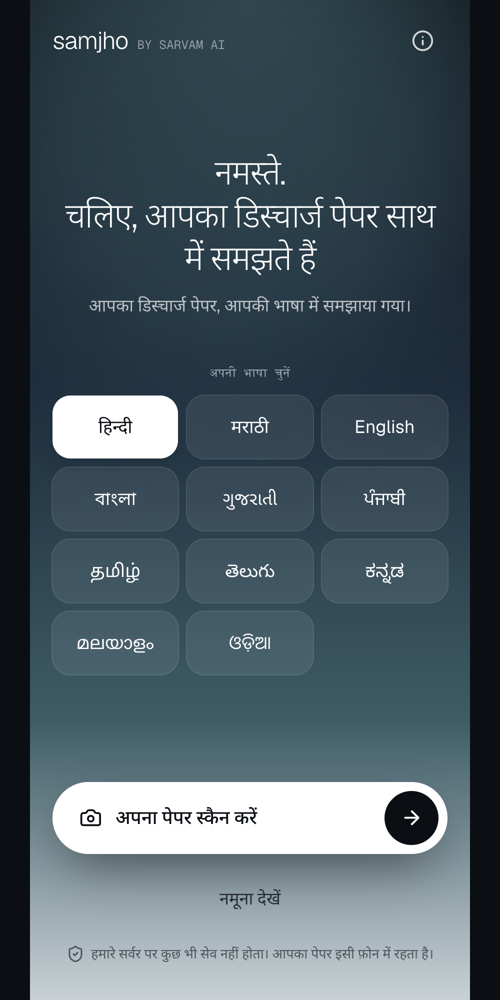
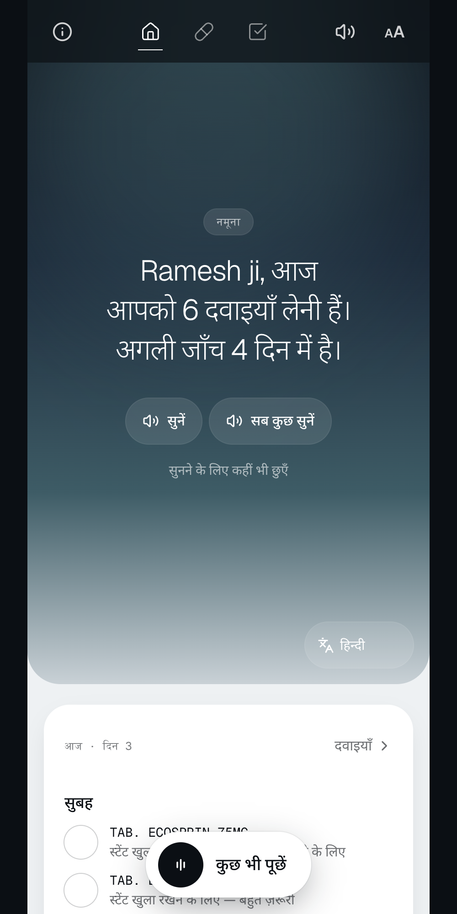
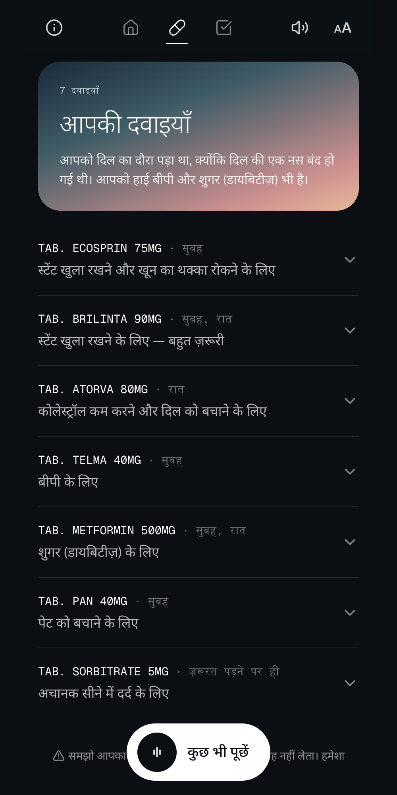
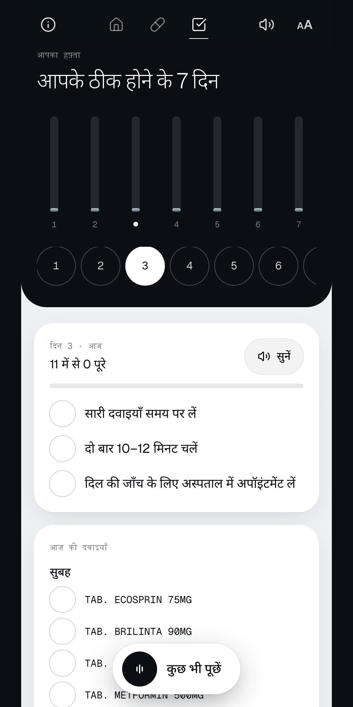
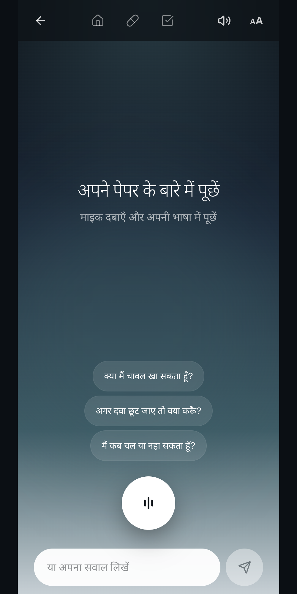
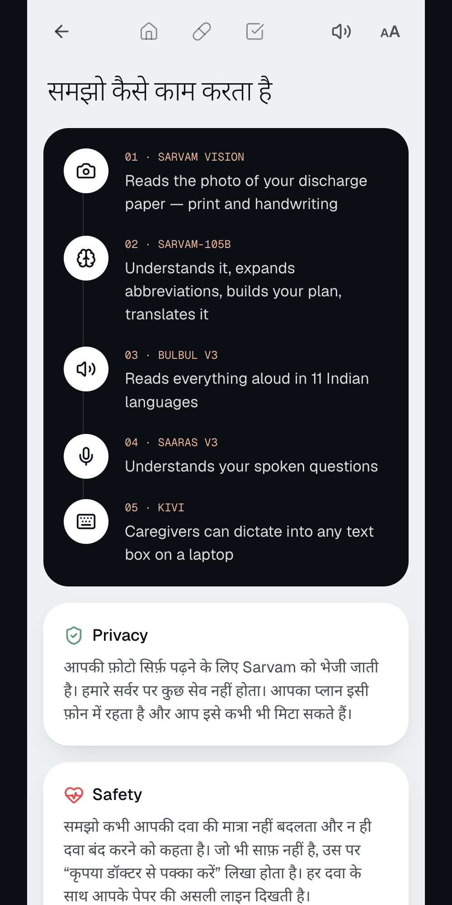
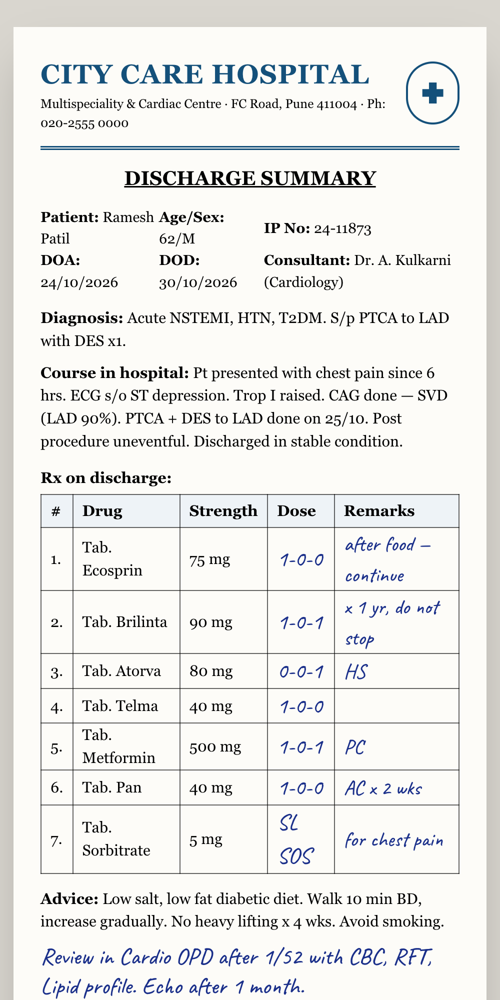
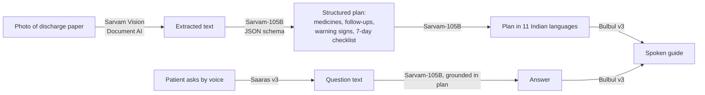

# Samjho — your discharge paper, explained in your language

**Live app:** https://samjho-ten.vercel.app · **Instant demo:** https://samjho-ten.vercel.app/plan?demo=1 · **Sample paper to photograph:** https://samjho-ten.vercel.app/sample-paper

Built for the Sarvam AI hackathon.

## The problem

Patients leave hospital with a dense discharge summary full of jargon and abbreviations: *BD, TDS, HS, SOS, AC/PC, "review after 1/52"*. Most can't tell which medicine is for what, when to take it, when to come back, or which symptoms mean "go to hospital now". The people most affected are often elderly or not fluent in English, and many can't read the paper at all. Missed doses and missed follow-ups lead to readmissions.

## The solution

Photograph the paper. Samjho reads it, turns it into a simple recovery plan, **speaks it in the patient's language**, and answers questions by voice. Every answer is grounded in the patient's own paper.

| Welcome | Your plan | Medicines | 7-day checklist |
|---|---|---|---|
|  |  |  |  |

| Ask by voice | How it works | Sample paper (for the live demo) |
|---|---|---|
|  |  |  |

## Sarvam pipeline



| Step | Sarvam product |
|---|---|
| Read the paper, including print and handwriting | **Sarvam Vision** (Document AI) |
| Understand, simplify, structure and translate | **Sarvam-105B** (`/v2/chat/completions`, strict JSON schema) |
| Speak it in 11 Indian languages | **Bulbul v3** (`/text-to-speech`) |
| Patient asks questions by voice | **Saaras v3** (`/speech-to-text`) |
| Caregiver dictation on a laptop | **Kivi**: every text field is a normal input, so system dictation works |

## Features

- Multi-page photo or PDF upload with client-side compression, and a live progress screen.
- **"From your paper"**: each medicine shows the exact line it came from.
- Hard-to-read items are flagged **"Please confirm with your doctor"**.
- 11 languages (हिन्दी, मराठी, বাংলা, ગુજરાતી, ಕನ್ನಡ, മലയാളം, ଓଡ଼ିଆ, ਪੰਜਾਬੀ, தமிழ், తెలుగు, English), with a listen button on every card and a "Listen to everything" mode.
- Voice and typed Q&A, answered only from the patient's paper.
- **Emergency guardrail**: serious symptoms such as chest pain or breathlessness show a red banner with a `tel:108` button.
- Today's dose timeline with ticks, a 7-day recovery checklist, an adherence chart and slide-to-confirm doses.
- Follow-up countdown with an `.ics` calendar download.
- Always-visible warning signs and a glossary of every abbreviation.
- Share to WhatsApp, plus a printable fridge sheet.
- Large-text mode, reduced-motion support and screen-reader labels.
- **Demo mode**: "Try a sample" works offline, with hand-written English, Hindi and Marathi plans.

## Privacy and safety

- No database and no login. The plan lives only in the browser's `localStorage`, and a **Clear my data** button removes it.
- The photo goes to Sarvam only to be read. The API key stays on the server and never reaches the browser.
- The model is instructed never to invent or change a dose, and never to suggest stopping a medicine. If the paper doesn't say something, the answer is "Your paper doesn't say, please ask your doctor".
- Emergency detection is checked twice: by the model, and by a keyword list on the server.

## Run locally

```bash
npm install
echo "SARVAM_API_KEY=your_key_here" > .env
npm run dev
```

Open http://localhost:3000. To test scanning, open `/sample-paper` on another screen and photograph it.

## Tech

Next.js 16 (App Router) · TypeScript · Tailwind CSS v4 · framer-motion · lucide-react · `sarvamai` SDK · deployed on Vercel.

```
app/            pages (welcome, scan, reading, plan, medicines, checklist, ask, how-it-works, sample-paper)
app/api/        scan, scan/[jobId], decode, translate, tts, ask — all Sarvam calls are server-side
components/     PlanProvider (state), UI kit, SlideToConfirm
lib/            sarvam.ts (API client), schema.ts, prompts.ts, i18n.ts, sample.ts, audio.ts, ics.ts
```

> Samjho explains your paper. It does not replace your doctor. Always follow your doctor's advice.
